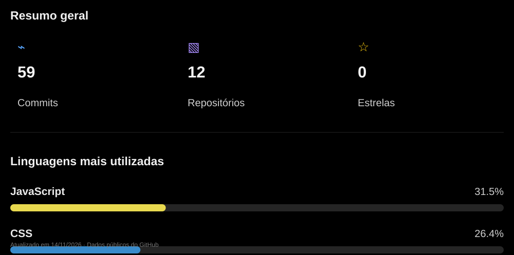

# Luis Eduardo 👋

**Estudante de Engenharia de Software | Desenvolvedor em formação**

---

## 📊 Meu GitHub em números

Estatísticas atualizadas automaticamente. Os dados consideram repositórios públicos próprios.

---

## 🛠️ Tecnologias que estou estudando

  
  &nbsp;&nbsp;
  
  &nbsp;&nbsp;
  

---

  Construindo, aprendendo e evoluindo um commit de cada vez. 🚀

